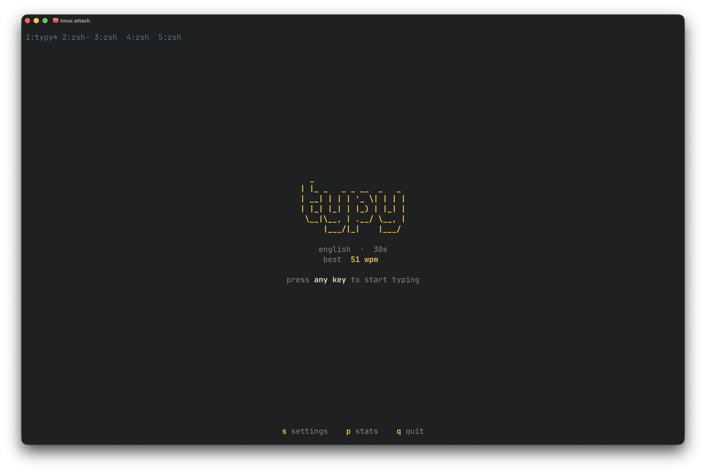
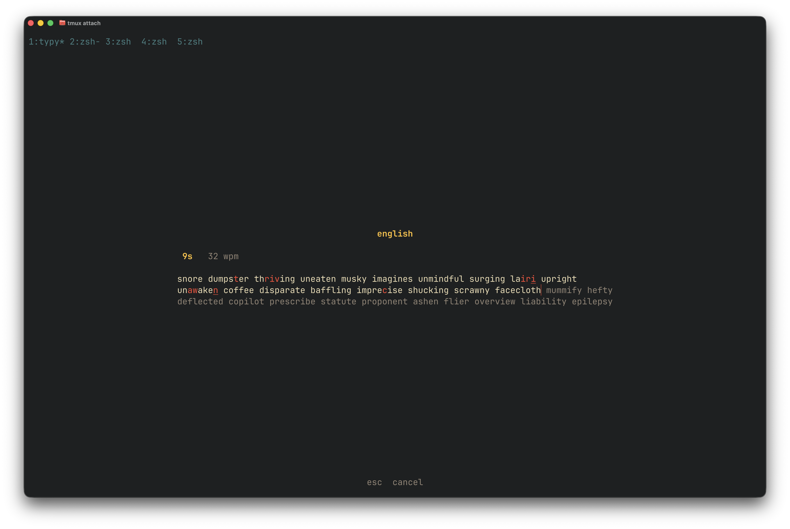
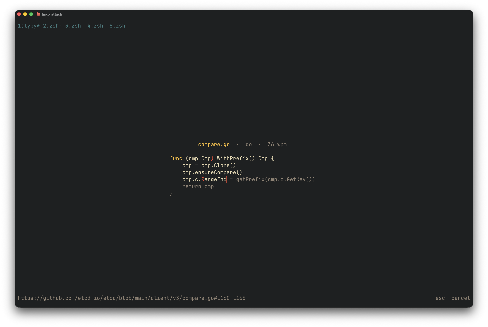
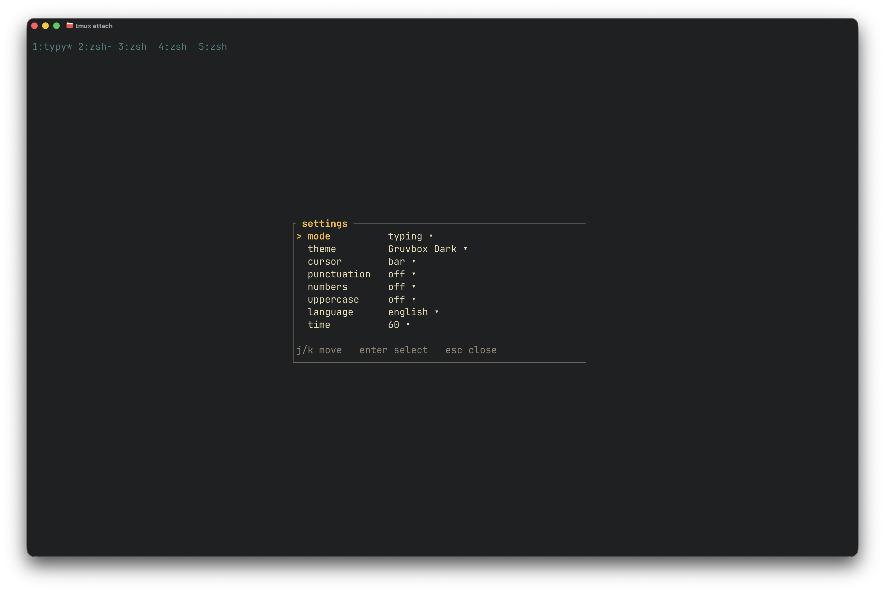
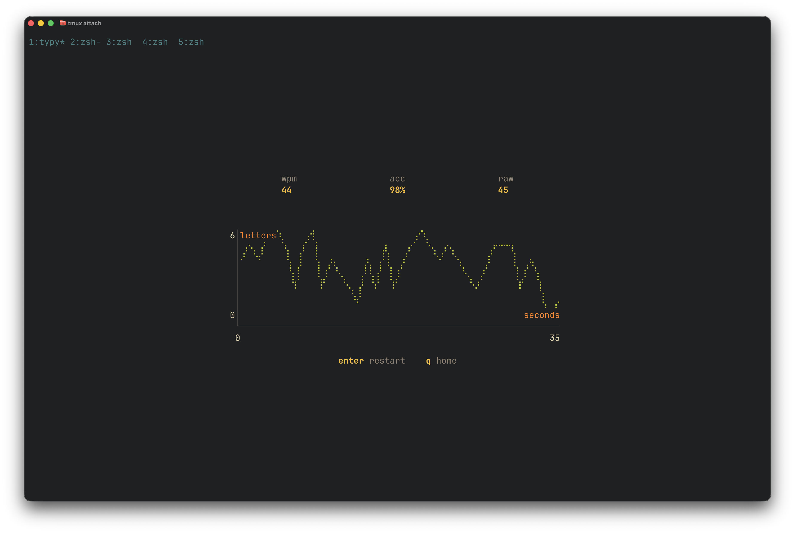
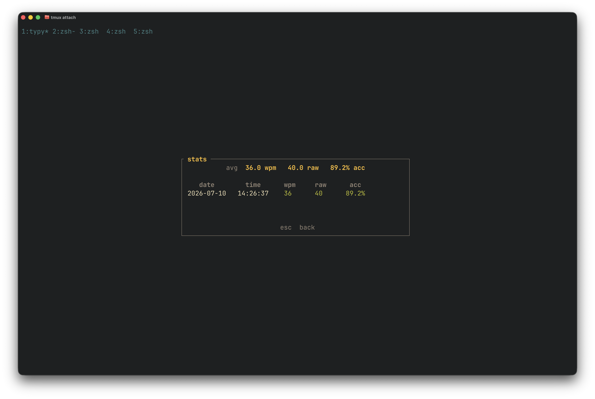

<div align="center">
  <pre>
,--------.,--.   ,--.,------.,--.   ,--.  
'--.  .--' \  `.'  / |  .--. '\  `.'  /  
   |  |     '.    /  |  '--' | '.    /   
   |  |       |  |   |  | --'    |  |    
   `--'       `--'   `--'        `--'    
  </pre>

  <b>A Monkeytype-style typing test for your terminal.</b>

  Type words or real code, watch your WPM, and pick a theme you like. Built with
  <a href="https://ratatui.rs/">ratatui</a>.

  <br/>

  
</div>

<br/>

> [!WARNING]
> When the terminal is too small it can lead to strange behavior. Give it some room.

## Table of contents
- [Overview](#overview)
- [Modes](#modes)
- [Installation](#installation)
- [Usage](#usage)
- [Keybindings](#keybindings)
- [Flags](#flags)
- [Configuration](#configuration)
- [Themes](#themes)
- [Cursor](#cursor)
- [Stats](#stats)
- [Language](#language)
- [Uninstall](#uninstall)

## Overview

I wanted a simple typing game to improve my speed and accuracy. I'm a fan of
[monkeytype](https://monkeytype.com/), so I built something similar for the terminal. Typy throws a
stream of random words at you (or a real code snippet), keeps track of your speed and accuracy, and
draws a little graph of your WPM at the end.

Later on I added the code mode for a more selfish reason: I was learning a new keyboard layout and
switching to a Corne keyboard, and typing prose gets you comfortable but it doesn't really
prepare you for code. All the brackets, symbols and indentation are exactly the parts that trip you
up on a new layout, so being able to drill on actual snippets made the transition a lot less painful.
If you're in the same boat, that's what code mode is for.

You don't have to remember any flags, run `typy` and everything (mode, theme, language, modifiers)
lives on the settings screen.

## Modes

<table>
  <tr>
    <td width="50%" valign="top">
      <b>Words</b><br/>
      Random words in whatever language you pick. Turn on punctuation, numbers or uppercase when you
      want it a bit harder.
    </td>
    <td width="50%" valign="top">
      <b>Code</b><br/>
      Real code snippets from open-source projects, highlighted with tree-sitter. Each one links back
      to where it came from. Great for getting used to symbols and indentation on a new layout or
      keyboard.
    </td>
  </tr>
  <tr>
    <td></td>
    <td></td>
  </tr>
</table>

<div align="center">
  <br/>
  <b>All of it is adjustable live from the settings screen</b><br/><br/>
  
</div>

## Installation
To install Typy, you can use the [Cargo] package manager:

[Cargo]: https://doc.rust-lang.org/cargo/

```bash
cargo install --git "https://github.com/Pazl27/typy-cli.git"
```

If you prefer to get the newest version and compile it yourself, follow these steps:

1. Clone the Typy repository:
    ```bash
    git clone https://github.com/Pazl27/typy-cli.git
    cd typy-cli
    ```

2. Compile the project:
    ```bash
    cargo build --release
    ```

3. Move the compiled binary to a directory in your PATH:
    ```bash
    sudo mv target/release/typy /usr/local/bin/
    ```

4. Ensure the `english.txt` file is in the correct location:
    ```bash
    mkdir -p ~/.local/share/typy
    cp resources/lang/english.txt ~/.local/share/typy/
    ```

If you have Nix with flakes enabled, you can install typy-cli directly:

```bash
nix profile install github:Pazl27/typy-cli
```

Or to run without installing:

```bash
nix run github:Pazl27/typy-cli
```

## Usage
Run `typy` with no arguments to open the interactive app. You start on the home screen, from where
you can begin a test, open the settings (`s`), or view your stats (`p`).

```bash
typy
```

If you pass a game option, Typy skips the home screen, runs one test straight away, shows the
results, and exits when you press a key. Handy when you just want a quick run:

```bash
# a 60s words test with punctuation and numbers
typy -m text -t 60 -x punctuation numbers

# type a random Rust snippet
typy -m code -l rust
```

## Keybindings

**Home**

| Key           | Action              |
| ------------- | ------------------- |
| any key       | start a test        |
| `s`           | open settings       |
| `p`           | open stats          |
| `q` / `Esc`   | quit                |

**Typing**

| Key            | Action                                    |
| -------------- | ----------------------------------------- |
| letters        | type the word / character                 |
| `Space`        | jump to the start of the next word        |
| `Backspace`    | delete the last character                 |
| `Esc`          | cancel (back to home, or quit in quick run) |

**Results / Stats / Settings**

| Key                 | Action                                    |
| ------------------- | ----------------------------------------- |
| any key (results)   | restart, or exit in quick run             |
| `Esc` / `q`         | back                                      |
| `j` / `k` (settings)| move between rows / dropdown options      |
| `Enter` (settings)  | open a dropdown / confirm a selection     |

`Ctrl + c` quits from anywhere.

## Flags
The `typy` application supports the following flags:

- `-m, --mode <MODE>`: What to type — `text` (words) or `code`. Default: `text`.
  - e.g., `typy -m code` types a random code snippet.

- `-l, --language <LANG>`: Language to use (works for both modes).
  - Text: `english`, `german`, ... (see [Language](#language)).
  - Code: `rust`, `python`, `go`, `c`, `cpp`, `javascript`, or `any`.

- `-x, --modifiers <MOD>...`: Extra text options (text mode only): `punctuation`, `numbers`,
  `uppercase`. Combine freely.
  - e.g., `typy -x punctuation numbers`.

- `-t, --time <SECONDS>`: Test duration in seconds (text mode). Runs a single test immediately.
  - e.g., `typy -t 60` runs a 60 second test.

- `-s, --stats`: Show statistics for your past games.

- `-c, --config`: Create the config file if it doesn't exist and open it in `$EDITOR`.

Run `typy --help` for the full help with usage examples.

## Configuration
Typy is configured via a TOML file located at `~/.config/typy/config.toml`. You can edit it directly
or open it with `typy -c`. Everything below can also be changed live from the in-app settings page
(`s` on the home screen), which writes your choices back to this file.

```toml
# ~/.config/typy/config.toml

theme = "Catppuccin Mocha"   # name of a built-in or custom theme (see Themes)
cursor = "block"             # caret style (see Cursor)
content = "words"            # "words" | "code" — what to type
code_language = "any"        # code mode language: any | rust | python | go | c | cpp | javascript

[modes]
default_mode = "normal"      # "normal" | "uppercase" | "punctuation" | "numbers", or a combination e.g. "punctuation, numbers"
uppercase_chance = "0.3"     # 0.0–1.0, clamped
punctuation_chance = "0.5"   # 0.0–1.0, clamped

[language]
lang = "english"             # word list to use (see Language)

[game]
time = 30                    # default test duration in seconds
```

## Themes
A theme is selected by name with the top-level `theme` key. Typy ships with several built-in themes:

- `Catppuccin Mocha` (default)
- `Gruvbox Dark`
- `Dracula`
- `Nord`
- `Tokyo Night`
- `Solarized Dark`
- `One Dark`
- `Rosé Pine`

You can pick one from the settings page, or set it directly:

```toml
theme = "Nord"
```

### Custom themes
To define your own themes, create `~/.config/typy/theme.toml` (next to `config.toml`). Each table is
one theme; its display name is the `name` field (falling back to the table key). Custom themes appear
in the settings dropdown alongside the built-ins and override a built-in with the same name.

```toml
# ~/.config/typy/theme.toml

[neon]
name = "Neon Dream"
fg = "#ffffff"
missing = "#555555"
error = "#ff0044"
accent = "#00ffcc"
graph_data = "#00ffcc"    # optional; graph_* fall back to sensible defaults
graph_title = "#ff00ff"
graph_axis = "#333333"
```

Then select it:

```toml
theme = "Neon Dream"
```

Colors are `#rrggbb` hex values. `fg` is correct text, `missing` is untyped text, `error` is
mistakes, and `accent` is the highlight color; `graph_data`, `graph_title` and `graph_axis` color the
results graph.

## Cursor
The typing caret uses your terminal's cursor. Set its style with the `cursor` key (or from settings):

```toml
cursor = "bar"
```

Possible values: `block`, `underline`, `bar`, and their blinking variants `blinking block`,
`blinking underline`, `blinking bar`.

## Stats
When you finish a test you get a results screen with your WPM, accuracy, and RAW numbers, plus a
per-second graph of your run:

<div align="center">
  
</div>

Your results are saved to `~/.local/share/typy/scores.json`, which keeps your last 10 games plus the
running averages for WPM, RAW and accuracy. It also remembers your best WPM for each test duration,
so you've always got a highscore to chase. You can revisit all of it any time:

- In the app: press `p` on the home screen.
- From the terminal: `typy -s`.

<div align="center">
  
</div>

Press `Esc` or `q` to close the view.

## Language
Word lists live in `~/.local/share/typy/` as `<language>.txt` files. The repository ships several
languages under `resources/lang/` (`english`, `german`, `french`, `italian`, `romanian`, `russian`,
`spanish`).

### How word lists are fetched
> [!IMPORTANT]
> `cargo install` only installs the `typy` binary — it does **not** copy any language files to your
> machine. The word lists are fetched **on demand, over the network**.

When you use a language for the first time, Typy looks for `~/.local/share/typy/<language>.txt`. If
it isn't there, it **downloads that one file** from GitHub
(`raw.githubusercontent.com/Pazl27/typy-cli/.../resources/lang/<language>.txt`) and saves it locally.
From then on it's read from disk and no network access is needed.

Code snippets work the same way: the snippet dataset is downloaded once from GitHub and then cached
under `~/.local/share/typy/code/`.

So, a few things to keep in mind:

- The first run needs an internet connection (to fetch at least `english`, or the code dataset). If
  GitHub is unreachable, starting a test fails with a download error.
- Only the language you actually use gets downloaded, not all of them.
- Downloads always come from the `master` branch, no matter which version/tag you installed.
- Themes are the exception. They're compiled into the binary, so they always work offline.
- The Nix package bundles `english.txt` and installs it on first launch, so Nix users are fine
  offline out of the box.

To use Typy fully offline (or to pre-seed languages), copy the files yourself:

```bash
mkdir -p ~/.local/share/typy
cp resources/lang/*.txt ~/.local/share/typy/   # from a cloned repo
```

Every `.txt` file found in `~/.local/share/typy/` is listed in the settings language dropdown — just
pick one. You can also set it in the config:

```toml
[language]
lang = "german"
```

To add your own language, drop a file in `~/.local/share/typy/` with one word per line:

```txt
word1
word2
...
```

Name it after the language (without the `.txt` extension). It will then show up in the settings
dropdown. Pull requests adding new languages to the repository are welcome.

## Uninstall
```bash
cargo uninstall typy
```
</content>
